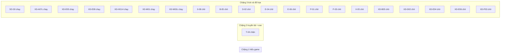

# TIẾN ĐỘ (tự sinh bằng TOOLS/tien_do.py lúc 2026-11-19 04:46, đừng sửa tay)

ĐANG LÀM: SO-30, XD-A07c, XD-E05, XD-E09, XD-HG14, XD-M01, XD-W02c
KẾ TIẾP: 0-08, B-05, D-02, E-04, E-06, P-01
BỊ CHẶN: T-04

Ba chặng #091: 1 hiểu game (chuẩn hóa) → 2 đường truyền + exe → 3 tick/độ phản hồi/đồ họa.

Tổng: 232 việc, 7 đang làm (+0 chết, 0 chờ gộp), 13 chờ, 1 bị chặn, 211 xong.
