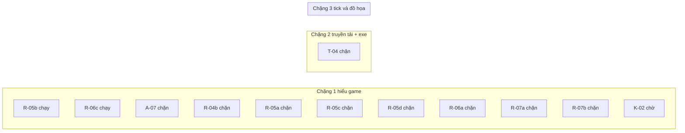

# TIẾN ĐỘ (tự sinh bằng TOOLS/tien_do.py lúc 2026-11-18 17:51, đừng sửa tay)

ĐANG LÀM: R-05b, R-06c
KẾ TIẾP: K-02
BỊ CHẶN: A-07, R-04b, R-05a, R-05c, R-05d, R-06a, R-07a, R-07b, T-04

Ba chặng #091: 1 hiểu game (chuẩn hóa) → 2 đường truyền + exe → 3 tick/độ phản hồi/đồ họa.

Tổng: 85 việc, 2 đang làm (+0 chết, 0 chờ gộp), 1 chờ, 9 bị chặn, 73 xong.
