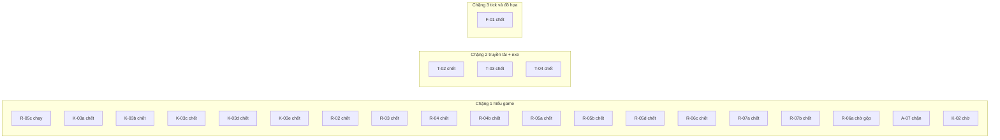

# TIẾN ĐỘ (tự sinh bằng TOOLS/tien_do.py lúc 2026-11-18 10:49, đừng sửa tay)

ĐANG LÀM: R-05c
KẾ TIẾP: K-02
BỊ CHẶN: A-07

Ba chặng #091: 1 hiểu game (chuẩn hóa) → 2 đường truyền + exe → 3 tick/độ phản hồi/đồ họa.

Tổng: 85 việc, 1 đang làm (+19 chết, 1 chờ gộp), 1 chờ, 1 bị chặn, 62 xong.
