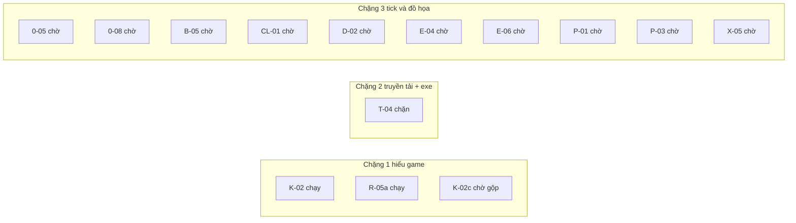

# TIẾN ĐỘ (tự sinh bằng TOOLS/tien_do.py lúc 2026-11-18 20:51, đừng sửa tay)

ĐANG LÀM: K-02, R-05a
KẾ TIẾP: 0-05, 0-08, B-05, CL-01, D-02, E-04
BỊ CHẶN: T-04

Ba chặng #091: 1 hiểu game (chuẩn hóa) → 2 đường truyền + exe → 3 tick/độ phản hồi/đồ họa.

Tổng: 129 việc, 2 đang làm (+0 chết, 1 chờ gộp), 10 chờ, 1 bị chặn, 115 xong.
