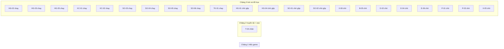

# TIẾN ĐỘ (tự sinh bằng TOOLS/tien_do.py lúc 2026-11-19 00:21, đừng sửa tay)

ĐANG LÀM: HG-02, HG-03, HG-05, KC-01, KC-02, SO-03, SO-04, SO-05, SO-06, TK-01
KẾ TIẾP: 0-08, B-05, D-02, E-04, E-06, P-01
BỊ CHẶN: T-04

Ba chặng #091: 1 hiểu game (chuẩn hóa) → 2 đường truyền + exe → 3 tick/độ phản hồi/đồ họa.

Tổng: 150 việc, 10 đang làm (+0 chết, 4 chờ gộp), 8 chờ, 1 bị chặn, 127 xong.
