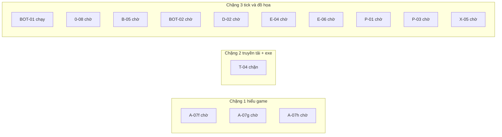

# TIẾN ĐỘ (tự sinh bằng TOOLS/tien_do.py lúc 2026-11-19 16:47, đừng sửa tay)

ĐANG LÀM: BOT-01
KẾ TIẾP: 0-08, A-07f, A-07g, A-07h, B-05, BOT-02
BỊ CHẶN: T-04

Ba chặng #091: 1 hiểu game (chuẩn hóa) → 2 đường truyền + exe → 3 tick/độ phản hồi/đồ họa.

Tổng: 244 việc, 1 đang làm (+0 chết, 0 chờ gộp), 12 chờ, 1 bị chặn, 230 xong.
