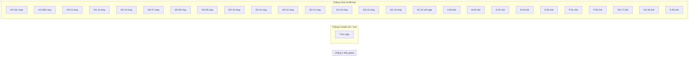

# TIẾN ĐỘ (tự sinh bằng TOOLS/tien_do.py lúc 2026-11-19 01:44, đừng sửa tay)

ĐANG LÀM: HG-03c, HG-05b, HG-11, HG-12, HG-13, SO-07, SO-08, SO-09, SO-10, SO-11, SO-12, SO-13, SO-14, SO-15, SO-16
KẾ TIẾP: 0-08, B-05, D-02, E-04, E-06, P-01
BỊ CHẶN: T-04

Ba chặng #091: 1 hiểu game (chuẩn hóa) → 2 đường truyền + exe → 3 tick/độ phản hồi/đồ họa.

Tổng: 180 việc, 15 đang làm (+0 chết, 1 chờ gộp), 10 chờ, 1 bị chặn, 153 xong.
