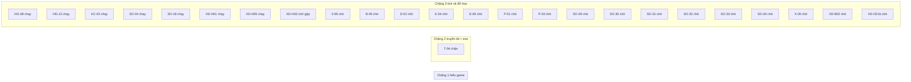

# TIẾN ĐỘ (tự sinh bằng TOOLS/tien_do.py lúc 2026-11-19 04:00, đừng sửa tay)

ĐANG LÀM: HG-08, HG-12, KC-02, SO-04, SO-18, XD-H01, XD-H05
KẾ TIẾP: 0-08, B-05, D-02, E-04, E-06, P-01
BỊ CHẶN: T-04

Ba chặng #091: 1 hiểu game (chuẩn hóa) → 2 đường truyền + exe → 3 tick/độ phản hồi/đồ họa.

Tổng: 225 việc, 7 đang làm (+0 chết, 1 chờ gộp), 16 chờ, 1 bị chặn, 200 xong.
