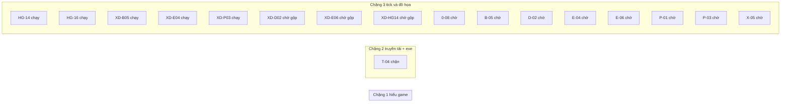

# TIẾN ĐỘ (tự sinh bằng TOOLS/tien_do.py lúc 2026-11-19 05:07, đừng sửa tay)

ĐANG LÀM: HG-14, HG-16, XD-B05, XD-E04, XD-P03
KẾ TIẾP: 0-08, B-05, D-02, E-04, E-06, P-01
BỊ CHẶN: T-04

Ba chặng #091: 1 hiểu game (chuẩn hóa) → 2 đường truyền + exe → 3 tick/độ phản hồi/đồ họa.

Tổng: 232 việc, 5 đang làm (+0 chết, 3 chờ gộp), 8 chờ, 1 bị chặn, 215 xong.
