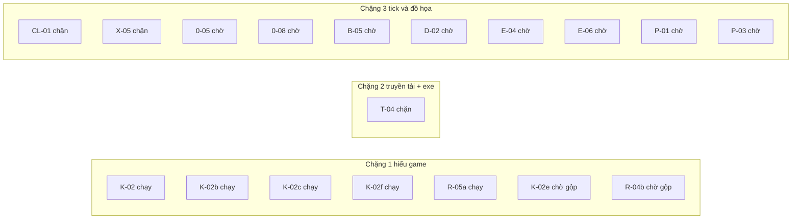

# TIẾN ĐỘ (tự sinh bằng TOOLS/tien_do.py lúc 2026-11-18 20:39, đừng sửa tay)

ĐANG LÀM: K-02, K-02b, K-02c, K-02f, R-05a
KẾ TIẾP: 0-05, 0-08, B-05, D-02, E-04, E-06
BỊ CHẶN: CL-01, T-04, X-05

Ba chặng #091: 1 hiểu game (chuẩn hóa) → 2 đường truyền + exe → 3 tick/độ phản hồi/đồ họa.

Tổng: 129 việc, 5 đang làm (+0 chết, 2 chờ gộp), 8 chờ, 3 bị chặn, 111 xong.
