# TIẾN ĐỘ (tự sinh bằng TOOLS/tien_do.py lúc 2026-11-19 01:24, đừng sửa tay)

ĐANG LÀM: HG-05b, HG-06, HG-07, HG-08, HG-09, HG-10, HG-11, KC-01, KV-03, KV-05, SO-11
KẾ TIẾP: 0-08, B-05, D-02, E-04, E-06, HG-03c
BỊ CHẶN: T-04

Ba chặng #091: 1 hiểu game (chuẩn hóa) → 2 đường truyền + exe → 3 tick/độ phản hồi/đồ họa.

```mermaid
flowchart LR
  subgraph S1["Chặng 1 hiểu game"]
  end
  subgraph S2["Chặng 2 truyền tải + exe"]
    T_04["T-04 chặn"]
  end
  subgraph S3["Chặng 3 tick và đồ họa"]
    HG_05b["HG-05b chạy"]
    HG_06["HG-06 chạy"]
    HG_07["HG-07 chạy"]
    HG_08["HG-08 chạy"]
    HG_09["HG-09 chạy"]
    HG_10["HG-10 chạy"]
    HG_11["HG-11 chạy"]
    KC_01["KC-01 chạy"]
    KV_03["KV-03 chạy"]
    KV_05["KV-05 chạy"]
    SO_11["SO-11 chạy"]
    0_08["0-08 chờ"]
    B_05["B-05 chờ"]
    D_02["D-02 chờ"]
    E_04["E-04 chờ"]
    E_06["E-06 chờ"]
    HG_03c["HG-03c chờ"]
    HG_12["HG-12 chờ"]
    HG_13["HG-13 chờ"]
    P_01["P-01 chờ"]
    P_03["P-03 chờ"]
    SO_07["SO-07 chờ"]
    SO_08["SO-08 chờ"]
    SO_09["SO-09 chờ"]
    SO_10["SO-10 chờ"]
    SO_12["SO-12 chờ"]
    SO_13["SO-13 chờ"]
    SO_14["SO-14 chờ"]
    SO_15["SO-15 chờ"]
  end
```

Tổng: 180 việc, 11 đang làm (+0 chết, 0 chờ gộp), 22 chờ, 1 bị chặn, 146 xong.
