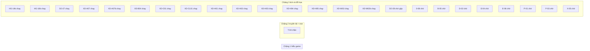

# TIẾN ĐỘ (tự sinh bằng TOOLS/tien_do.py lúc 2026-11-19 03:36, đừng sửa tay)

ĐANG LÀM: HG-14b, HG-16b, SO-27, XD-A07, XD-A07b, XD-B04, XD-C01, XD-CL01, XD-H01, XD-H02, XD-H03, XD-H04, XD-H05, XD-W02, XD-W02b
KẾ TIẾP: 0-08, B-05, D-02, E-04, E-06, P-01
BỊ CHẶN: T-04

Ba chặng #091: 1 hiểu game (chuẩn hóa) → 2 đường truyền + exe → 3 tick/độ phản hồi/đồ họa.

Tổng: 217 việc, 15 đang làm (+0 chết, 1 chờ gộp), 8 chờ, 1 bị chặn, 192 xong.
