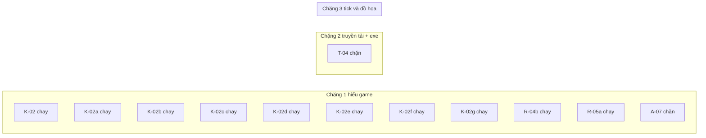

# TIẾN ĐỘ (tự sinh bằng TOOLS/tien_do.py lúc 2026-11-18 19:53, đừng sửa tay)

ĐANG LÀM: K-02, K-02a, K-02b, K-02c, K-02d, K-02e, K-02f, K-02g, R-04b, R-05a
KẾ TIẾP: (không)
BỊ CHẶN: A-07, T-04

Ba chặng #091: 1 hiểu game (chuẩn hóa) → 2 đường truyền + exe → 3 tick/độ phản hồi/đồ họa.

Tổng: 98 việc, 10 đang làm (+0 chết, 0 chờ gộp), 0 chờ, 2 bị chặn, 86 xong.
