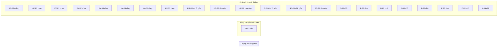

# TIẾN ĐỘ (tự sinh bằng TOOLS/tien_do.py lúc 2026-11-19 00:56, đừng sửa tay)

ĐANG LÀM: HG-02b, KC-01, KV-01, KV-02, KV-03, KV-04, KV-05, KV-06
KẾ TIẾP: 0-08, B-05, D-02, E-04, E-06, P-01
BỊ CHẶN: T-04

Ba chặng #091: 1 hiểu game (chuẩn hóa) → 2 đường truyền + exe → 3 tick/độ phản hồi/đồ họa.

Tổng: 158 việc, 8 đang làm (+0 chết, 6 chờ gộp), 8 chờ, 1 bị chặn, 135 xong.
