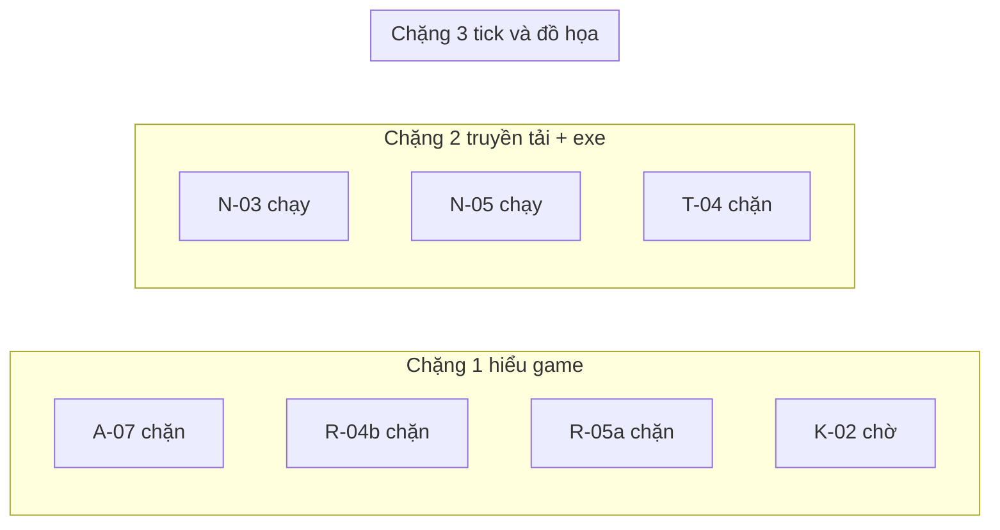

# TIẾN ĐỘ (tự sinh bằng TOOLS/tien_do.py lúc 2026-11-18 19:04, đừng sửa tay)

ĐANG LÀM: N-03, N-05
KẾ TIẾP: K-02
BỊ CHẶN: A-07, R-04b, R-05a, T-04

Ba chặng #091: 1 hiểu game (chuẩn hóa) → 2 đường truyền + exe → 3 tick/độ phản hồi/đồ họa.

Tổng: 91 việc, 2 đang làm (+0 chết, 0 chờ gộp), 1 chờ, 4 bị chặn, 84 xong.
