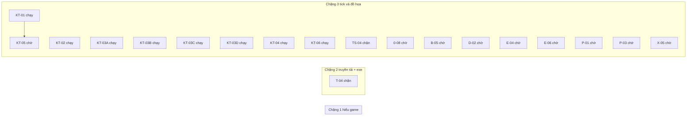

# TIẾN ĐỘ (tự sinh bằng TOOLS/tien_do.py lúc 2026-11-20 12:33, đừng sửa tay)

ĐANG LÀM: KT-01, KT-02, KT-03A, KT-03B, KT-03C, KT-03D, KT-04, KT-06
KẾ TIẾP: 0-08, B-05, D-02, E-04, E-06, KT-05
BỊ CHẶN: T-04, TS-04

Ba chặng #091: 1 hiểu game (chuẩn hóa) → 2 đường truyền + exe → 3 tick/độ phản hồi/đồ họa.

Tổng: 274 việc, 8 đang làm (+0 chết, 0 chờ gộp), 9 chờ, 2 bị chặn, 255 xong.
