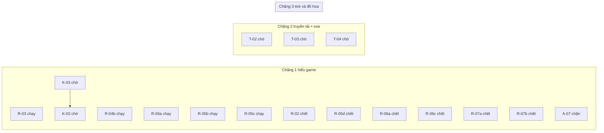

# TIẾN ĐỘ (tự sinh bằng TOOLS/tien_do.py lúc 2026-11-18 09:24, đừng sửa tay)

ĐANG LÀM: R-03, R-04b, R-05a, R-05b, R-05c
KẾ TIẾP: K-02, K-03, T-02, T-03, T-04
BỊ CHẶN: A-07

Ba chặng #091: 1 hiểu game (chuẩn hóa) → 2 đường truyền + exe → 3 tick/độ phản hồi/đồ họa.

Tổng: 79 việc, 5 đang làm (+6 chết, 0 chờ gộp), 5 chờ, 1 bị chặn, 62 xong.
