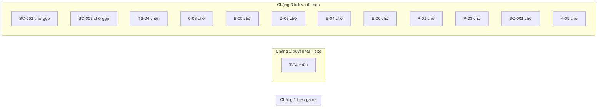

# TIẾN ĐỘ (tự sinh bằng TOOLS/tien_do.py lúc 2026-11-20 20:35, đừng sửa tay)

ĐANG LÀM: (không)
KẾ TIẾP: 0-08, B-05, D-02, E-04, E-06, P-01
BỊ CHẶN: T-04, TS-04

Ba chặng #091: 1 hiểu game (chuẩn hóa) → 2 đường truyền + exe → 3 tick/độ phản hồi/đồ họa.

Tổng: 277 việc, 0 đang làm (+0 chết, 2 chờ gộp), 9 chờ, 2 bị chặn, 264 xong.
