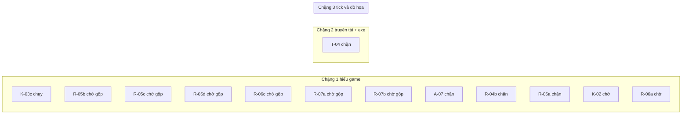

# TIẾN ĐỘ (tự sinh bằng TOOLS/tien_do.py lúc 2026-11-18 16:39, đừng sửa tay)

ĐANG LÀM: K-03c
KẾ TIẾP: K-02, R-06a
BỊ CHẶN: A-07, R-04b, R-05a, T-04

Ba chặng #091: 1 hiểu game (chuẩn hóa) → 2 đường truyền + exe → 3 tick/độ phản hồi/đồ họa.

Tổng: 85 việc, 1 đang làm (+0 chết, 6 chờ gộp), 2 chờ, 4 bị chặn, 72 xong.
